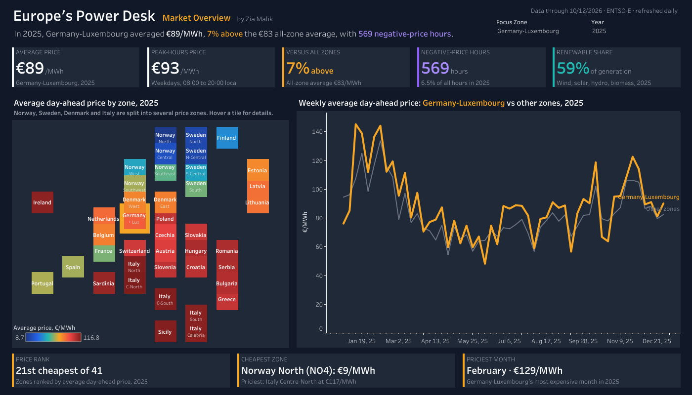
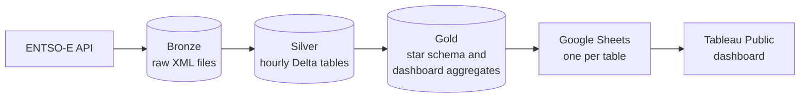
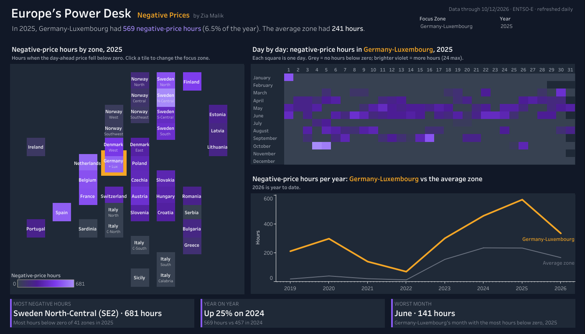
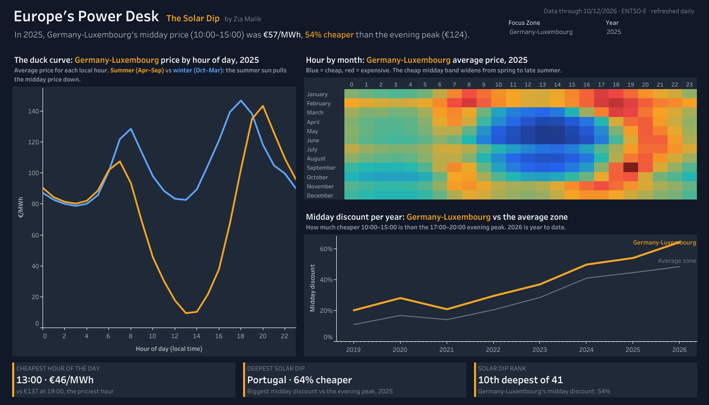
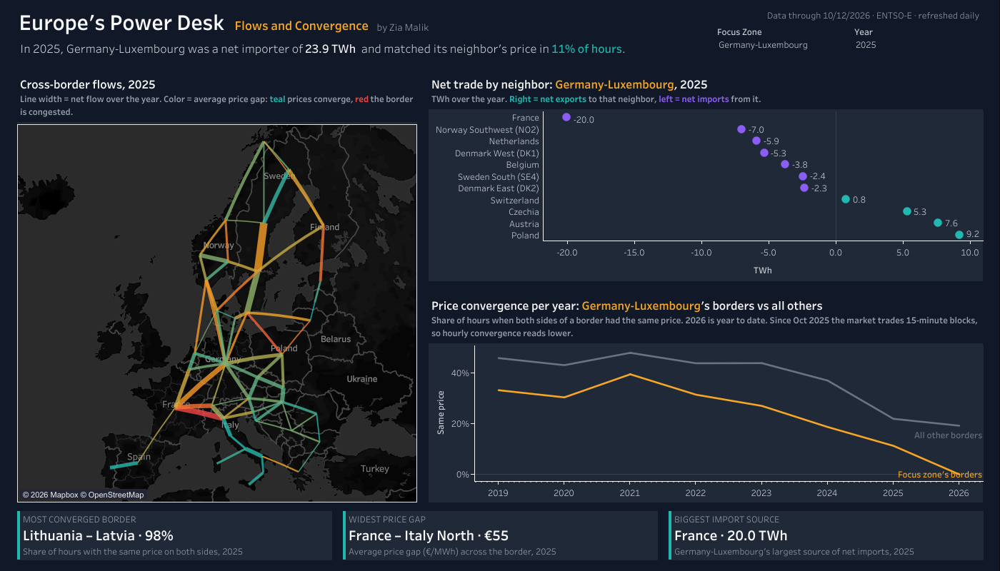
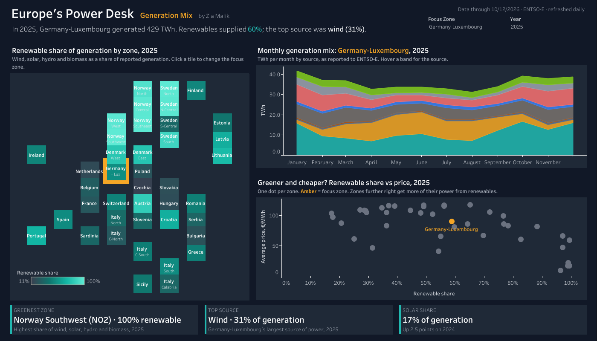
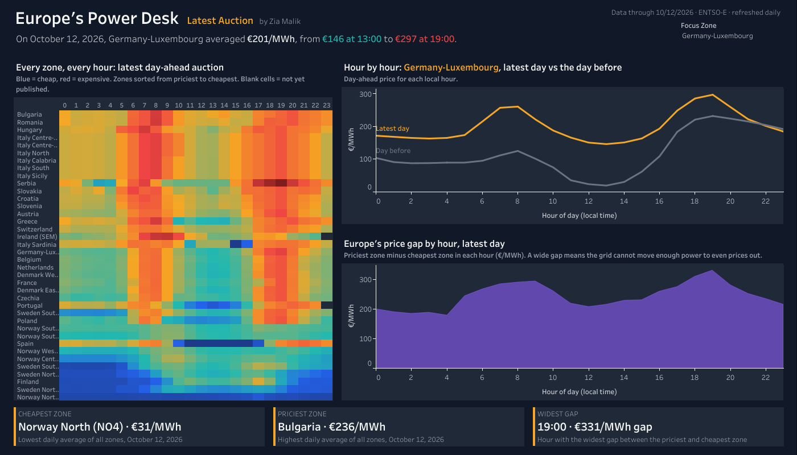

# Europe's Power Desk: Where, When and Why Electricity Gets Cheap

I built this project to answer the questions an energy trader or analyst asks every morning about European power: where electricity is cheap or expensive, when prices go below zero, how solar reshapes the day, how much neighbors trade with each other, and what each country generates.

I used seven years of official hourly data for 41 European bidding zones and built the full pipeline on Databricks, from raw API files to a Tableau dashboard that refreshes every day.

`Databricks` · `PySpark` · `Spark SQL` · `Delta Lake` · `Python` · `Tableau` · `Google Sheets API` · `Claude (AI-assisted development)`

**[▶ Open the live dashboard](https://public.tableau.com/views/EuropesPowerDesk/MarketOverview)**

---

## The project in numbers

| | |
|---|---|
| **Data** | ENTSO-E Transparency Platform: day-ahead prices, actual generation by source, load, installed capacity and cross-border physical flows |
| **Coverage** | 41 bidding zones, January 2019 to today, hourly |
| **Size** | About 8 GB of raw XML in 3,300+ files, loaded into about 47 million rows |
| **Platform** | Databricks Free Edition: Unity Catalog, Delta tables, a scheduled job |
| **Refresh** | Daily at 15:00 Brussels time, after the day-ahead auction results are published |
| **Dashboard** | 7 pages in Tableau Public, refreshed from Google Sheets every day |

---

## What I found

- **Prices are far apart across Europe.** In 2025, Germany-Luxembourg averaged €89/MWh. Norway North averaged €9 and Italy Centre-North €117, all in the same market.
- **Negative prices are now routine.** Germany-Luxembourg had 569 hours below zero in 2025, up from 211 in 2019, or 6.5% of the year. Central Sweden (SE2) had the most of any zone, with 681 hours.
- **Solar has carved a dip into the day.** In Germany-Luxembourg, midday power (10:00–15:00) cost €57 in 2025, against €124 in the evening peak, 54% cheaper. Portugal had the deepest dip, at 64%.
- **Germany buys power from its neighbors.** Germany-Luxembourg was a net importer of 23.9 TWh in 2025 across 11 borders, with France its biggest supplier (20.0 TWh).
- **Renewables supply most of Germany's power.** 60% of its reported generation in 2025, with wind alone at 31%.
- **Policy shows up in the data.** In 2022, Spain averaged €168/MWh, 24% below the European average, the year the Iberian gas price cap came in.

---

## How I built it

**Ingestion (Python)**
- A small API client requests six datasets per zone, retries with backoff, stays under the API rate limit and saves every response untouched to a Unity Catalog volume.
- Every call is written to a log table, which doubles as the manifest of files still waiting to be loaded.
- A watermark per zone and dataset means the daily run only fetches what's new, with a three-day look-back to pick up late corrections.

**Silver (PySpark and Delta Lake)**
- A parser turns ENTSO-E's nested XML into rows and fills the gaps the format leaves on purpose (repeated values are only sent once).
- I convert every timestamp to the zone's local date and hour, so daylight-saving days have 23 or 25 hours, as they should.
- Loads are idempotent: every batch is a Delta `MERGE` upsert, so a rerun or a corrected file never creates duplicates.

**Gold (Spark SQL)**
- Dimensions for zones, fuels, borders and dates, plus a 41-zone tile grid for the dashboard map.
- Aggregate tables shaped for each page: daily prices, hourly price profiles, monthly generation, monthly border flows and the latest auction.

**Serving and scheduling**
- A Databricks job runs four tasks every day: ingest, silver, gold and export, with an email if anything fails.
- The export writes each gold table to its own Google Sheet through a service account. Tableau Public reads the sheets and refreshes the dashboard daily.
- The API token and service-account key live in a Databricks secret scope, never in code.

---

## The dashboard

| Page | The question it answers |
|---|---|
| **Market Overview** | Where is power cheap or expensive, and how has the focus zone's price moved? |
| **Negative Prices** | Where and when do prices fall below zero, and is it getting more common? |
| **The Solar Dip** | How much cheaper is midday power, and how has that changed over the years? |
| **Flows and Convergence** | Who trades with whom, who imports, and how often do neighbors share one price? |
| **Generation Mix** | What does each zone generate, and do greener zones pay less? |
| **Latest Auction** | What did every zone pay, hour by hour, in the most recent auction? |
| **Notes** | Sources, definitions and caveats |

Pick a focus zone and a year at the top, or click any tile on a map. Every headline and "What stands out" card rewrites itself, for example *"In 2025, Germany-Luxembourg had 569 negative-price hours (6.5% of the year). The average zone had 241 hours."*

---

## Problems I found in the data, and how I fixed them

| What was wrong | What it would have caused | What I did |
|---|---|---|
| Before October 2025, price files hold two series: the official hourly auction and a separate 15-minute product that doesn't average to it | Wrong prices for every zone that publishes both | Kept the hourly series when present. After October 2025 only 15-minute prices exist, so I average them to hourly |
| Timestamps are in UTC, but markets trade in local time | Solar dips and evening peaks shifted by one or two hours | Converted to each zone's local date and hour, daylight saving included |
| The backfill kept failing after long runs | A load that never finished | Found that listing thousands of files on the volume was what hung. Switched to reading pending files from the pipeline's own call log and gave the silver step its own job task |
| Tableau's Google connector downloads a sheet as an Excel file, and Google refuses exports over about 10 MB | A dashboard that couldn't refresh | Split the export into one sheet per table and trimmed the daily table to the 11 columns the dashboard uses |
| The latest day is still incomplete when the job runs | A false drop at the end of every trend | Daily aggregates only include complete days |
| Pumped-storage plants report the power they use to pump water back up as generation | Overstated renewable shares | Left pumping consumption out of the renewable share |

To check the pipeline, I compared Germany-Luxembourg's yearly average prices with published German figures. They match: €235.45/MWh in 2022, €95.18 in 2023 and €89.44 in 2025.

---

## How I measure things

- **Average price** is the average of daily average day-ahead prices over the period, in €/MWh.
- **Negative-price hour** is an hour with a day-ahead price below €0/MWh.
- **Midday discount** compares 10:00–15:00 with the 17:00–20:00 evening peak, in local time: 1 − midday price ÷ evening price.
- **Converged border** means both sides cleared at the same price in an hour (a gap under €0.01/MWh).
- **Net flow** is physical exports minus imports across a border, in TWh.
- **Renewable share** is wind, solar, hydro and biomass as a share of reported generation.
- **Average zone** is the total for all 41 zones divided by 41.

**Caveats.** Since October 2025 the auction clears in 15-minute blocks, so hourly convergence reads lower from that date. Some zones under-report generation (for example, Dutch rooftop solar), so their renewable share is understated. A few zones publish the latest auction late, and their cells stay blank until the next refresh.

---

## What's in this repository

- `src/`: the pipeline code
  - `entsoe_client.py`: the API client (requests, retries, rate limit, raw file storage, call log)
  - `entsoe_parser.py`: XML to rows, including gap filling
  - `silver_loader.py`: silver tables with Delta `MERGE` upserts
  - `orchestrator.py`: incremental fetching with watermarks and checkpoints
  - `sheets_export.py`: gold tables to Google Sheets, with an export-size check
- `notebooks/`: Databricks notebooks, in run order
  - `00_setup/`: connectivity, secrets, catalog, schemas and the raw file index
  - `01_reference/`: zone, fuel, border and date dimensions
  - `02_ingestion/`: tests, the ingest task and the silver task
  - `03_gold/`: star schema and dashboard aggregates
  - `04_serving/`: the Google Sheets export task
- `images/`: dashboard screenshots

The raw data and the Tableau workbook are not in this repository. You can explore the live dashboard through the link at the top, and download the workbook from Tableau Public.

---

*Data: ENTSO-E Transparency Platform. This is my own independent analysis, not investment advice, and is not linked to or approved by ENTSO-E.*

**Zia Malik** · Senior Data Analyst
